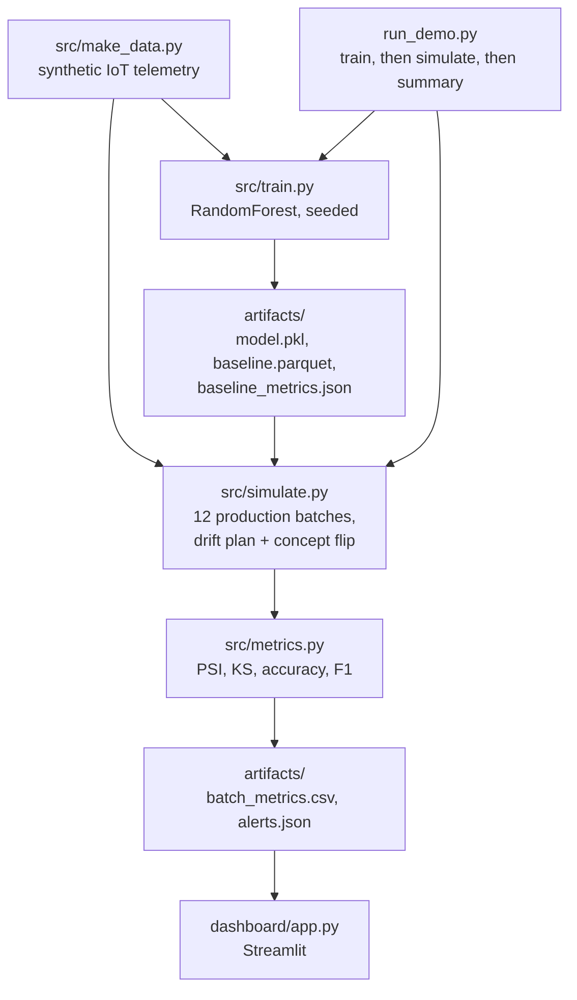

# ML Monitoring Dashboard — IoT Device Failure Predictor

I'm **Pavan Kalyan**, an MS Data Science student at Wentworth Institute of Technology (Boston, graduating Dec 2026) with 3 years of experience as a Software Test Engineer / SDET in IoT device testing. This project simulates what I actually worried about in that role: **a deployed classifier silently going stale**. I built a full monitoring loop — synthetic IoT telemetry, a trained failure-prediction model, from-scratch drift metrics, an alert pipeline, and a Streamlit dashboard — that answers one question: *"Would my monitoring have caught the degradation before users did?"*

## What it does

- Generates synthetic IoT device telemetry (temperature, humidity, battery voltage, signal strength, uptime) with a binary `will_fail` label
- Trains a RandomForest failure classifier and snapshots training features as the drift baseline
- Simulates 12 sequential "production" batches with injected drift: clean → gradual sensor drift → severe drift + concept drift
- Computes **PSI** and **two-sample KS** per feature per batch (implemented from scratch, no `evidently`), plus accuracy/F1 per batch
- Raises alerts when PSI > 0.25 on any feature or accuracy drops > 5 pts vs baseline
- Visualizes everything in a Streamlit dashboard: batch slider, accuracy/F1 decay curve, PSI heatmap, prediction-rate shift, alerts panel

## Real results from the demo run

Baseline (held-out test): **accuracy 0.810**, F1 0.496, predicted failure rate 0.130.

| batch | accuracy | F1 | max PSI (feature) | alert? |
|------:|---------:|---:|-------------------|--------|
| 1 | 0.828 | 0.577 | 0.043 (battery_v) | – |
| 2 | 0.845 | 0.530 | 0.049 (temp_c) | – |
| 3 | 0.820 | 0.576 | 0.041 (humidity) | – |
| 4 | 0.823 | 0.466 | 0.039 (uptime_hrs) | – |
| **5** | **0.762** | 0.592 | **0.558 (battery_v)** | **🚨 drift** |
| 6 | 0.705 | 0.665 | 3.828 (battery_v) | 🚨 drift + accuracy |
| 7 | 0.623 | 0.672 | 6.455 (battery_v) | 🚨 drift + accuracy |
| 8 | 0.590 | 0.686 | 9.405 (battery_v) | 🚨 drift + accuracy |
| 9 | 0.637 | 0.749 | 11.408 (battery_v) | 🚨 drift + accuracy |
| 10 | 0.700 | 0.816 | 12.434 (battery_v) | 🚨 drift + accuracy |
| 11 | 0.675 | 0.800 | 12.434 (battery_v) | 🚨 drift + accuracy |
| 12 | 0.672 | 0.800 | 12.434 (battery_v) | 🚨 drift + accuracy |

What I take from this:

- **Drift was detected in batch 5** — the first drifted batch — when accuracy had only slipped from 0.810 to 0.762 (−4.8 pts, *below* the 5-pt accuracy alert). The PSI alert fired a full batch before the accuracy alert would have. That's exactly the early-warning behavior you want in production.
- **Accuracy decayed from 0.810 to 0.672** over the 12 batches, bottoming at 0.590 in batch 8 (a 22-pt drop vs baseline).
- **F1 counter-intuitively rose** (0.496 → 0.800). The drift pushed more devices into the failure region, so the model's positive rate climbed and recall inflated F1 — a good reminder to never trust a single metric in isolation when the data distribution moves.
- PSI saturates (~12.4) once a feature fully leaves the baseline range — it flags severity well but loses granularity past "totally shifted," which is where KS complements it.

## Project structure

```
ml-monitoring-dashboard/
├── src/
│   ├── make_data.py   # synthetic IoT telemetry; make_batch(n, drift_shift, concept_flip)
│   ├── train.py       # trains RandomForest → artifacts/model.pkl, baseline.parquet, baseline_metrics.json
│   ├── metrics.py     # from-scratch PSI, PSI bands, two-sample KS, per-batch metrics
│   └── simulate.py    # 12 production batches with drift plan → batch_metrics.csv, alerts.json
├── dashboard/
│   └── app.py         # Streamlit dashboard (batch slider, decay chart, PSI heatmap, alerts)
├── tests/             # pytest suite (39 tests): data gen, metrics, training, simulation
│   ├── test_make_data.py
│   ├── test_metrics.py
│   ├── test_train.py
│   └── test_simulate.py
├── examples/
│   └── drift_walkthrough.py   # runnable PSI/KS alert workflow on synthetic batches
├── artifacts/         # generated by the demo (model, baseline, metrics, alerts)
├── run_demo.py        # one-command end-to-end + console summary table
├── Makefile           # setup / test / demo / dashboard shortcuts
├── .github/workflows/ci.yml   # byte-compile + pytest on push/PR
└── requirements.txt
```

## Architecture



## How to run

```bash
# from the project root
python run_demo.py          # trains, simulates 12 batches, prints the summary table
streamlit run dashboard/app.py   # opens the monitoring dashboard

# shortcuts (same commands, less typing)
make demo                   # train + simulate + summary table
make test                   # run the pytest suite
make dashboard              # launch the Streamlit dashboard
```

## Tests and CI

39 pytest tests, all offline and self-contained — the train/simulate tests
run against tmp artifact dirs, so they never touch the committed `artifacts/`:

- `tests/test_make_data.py` — generator schema, seeded determinism, drift and label-flip behavior
- `tests/test_metrics.py` — PSI/KS on identical, same-distribution and shifted samples; band boundaries; `batch_metrics` schema
- `tests/test_train.py` — baseline dict shape, exact seeded metrics (accuracy 0.81, F1 0.496), artifacts written, training determinism
- `tests/test_simulate.py` — drift-plan boundaries, 12-row output, first alert on batch 5, accuracy decay under drift

```bash
python -m pytest tests -q        # or: make test
```

GitHub Actions (`.github/workflows/ci.yml`) byte-compiles the sources and runs the suite on every push/PR to main.

## Key design decisions

- **Why PSI + KS instead of one of them?** PSI is the industry-standard, interpretable band metric (<0.1 no shift, 0.1–0.25 small, >0.25 major), but it saturates under extreme shifts. KS gives a complementary distribution-distance number (0–1) that stays informative. Using both avoids a blind spot I would have had with either alone.
- **Threshold choices:** PSI > 0.25 for a "major shift" alert follows standard PSI banding; the 5-point accuracy-drop bar is deliberately tighter than most teams' 10-pt trigger because catching drift early is the point — in this run it meant the drift alert fired one batch *before* the performance alert.
- **From-scratch metrics:** I deliberately avoided `evidently` so the math (quantile binning, epsilon smoothing, ECDF distance) is visible, testable pure functions — verified against same-distribution (≈0) and shifted-distribution (≈1.9) synthetic checks.
- **Seeded RNGs everywhere** (`make_batch` takes explicit seeds), so the whole pipeline is reproducible.
- **In real production labels are usually missing or delayed** — here accuracy/F1 use simulated labels. For a real deployment I would add: (1) proxy metrics that don't need labels (prediction-distribution PSI, prediction entropy, feature drift as leading indicators), (2) delayed-label backfill to compute true accuracy when failure confirmations arrive, and (3) a scheduled retrain trigger when alerts persist across N consecutive batches rather than a one-off batch.

## FAQ / troubleshooting

- **The dashboard says "Artifacts not found."** Run `python run_demo.py` (or `make demo`) from the project root first — the dashboard only reads `artifacts/`, it never trains.
- **pytest fails with `ModuleNotFoundError: make_data`.** Run pytest from the project root; the test modules add `src/` to the path themselves. Running a test file directly with `python tests/test_train.py` does not work.
- **Parquet errors (`Unable to find a usable engine`).** `pyarrow` is a required dependency for the baseline snapshot — `pip install -r requirements.txt` (or `make setup`).
- **Can I change the drift scenario?** Yes — edit `batch_plan()` in `src/simulate.py` (which batches drift, how fast, how much label flipping), then re-run the demo. The alert thresholds live in `src/metrics.py` (`PSI_ALERT`, `ACCURACY_DROP_ALERT`).
- **Why does F1 rise while accuracy falls?** The drift pushes more devices into the failure region, so the model's positive rate climbs and recall inflates F1 — see the takeaways under "Real results from the demo run" above. Never trust a single metric in isolation when the distribution moves.

## Skills this shows

Python (pandas, NumPy, scikit-learn), statistical drift detection (PSI, KS), Streamlit dashboards, matplotlib, simulation design for QA-style validation, alerting/threshold design, reproducible ML pipelines.
